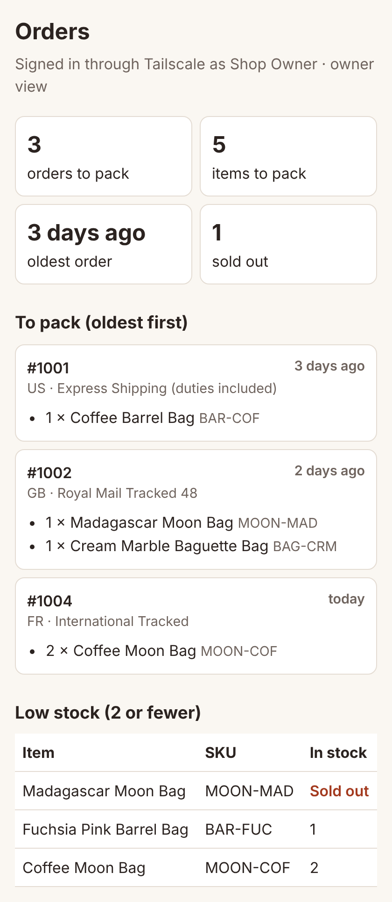
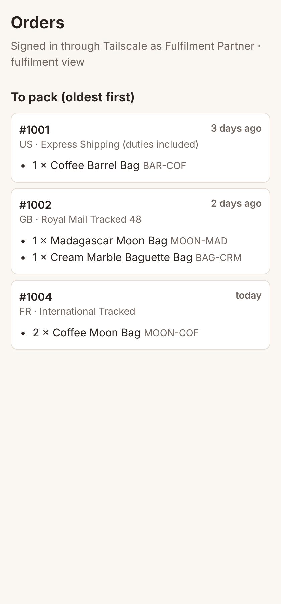
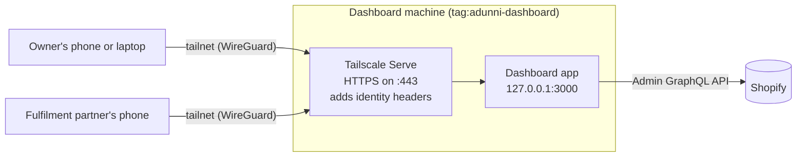

# Adunni Fulfilment Dashboard

A private orders and stock dashboard for a small online shop, shared with a fulfilment partner over [Tailscale](https://tailscale.com). It never goes on the public internet. Who can open it is decided by the tailnet policy, and what each person sees is decided by the identity Tailscale passes to the app.

| Owner view | Fulfilment view |
| --- | --- |
|  |  |

## Why I built it

I run [By Adunni](https://byadunni.com), a handmade beaded bag brand. I'm often abroad, and my cousin packs and ships orders from the UK. We both need the same live answer to "what needs packing today?", and I also want to see what's running low.

The usual options didn't fit. Giving my cousin a Shopify staff account shows far more than she needs. Putting a dashboard on the public internet means building logins, and exposing order data to the world if I get it wrong.

With Tailscale, the dashboard runs on one machine and is only reachable by people on my tailnet. Tailscale already knows who each person is, so the app doesn't need its own login system.

## How it works



Access is decided in two layers:

1. **The tailnet policy decides who can reach the machine.** Only the owners and fulfilment groups can connect, and only on port 443. See [`tailscale/policy.example.hujson`](tailscale/policy.example.hujson).
2. **The app decides what each person sees.** Tailscale Serve forwards each request with `Tailscale-User-Login` and `Tailscale-User-Name` headers. The app looks the login up in `roles.json`:
   - **owner:** summary, packing list and low stock
   - **fulfilment:** packing list only (the stock API returns 403)
   - **anyone else on the tailnet:** 403

The network policy can't tell the app which page someone may see, and the app can't stop someone reaching the machine. Each layer covers what the other can't.

## Try it locally (no Tailscale or Shopify needed)

Needs Node 18 or newer.

```bash
npm install
cp roles.example.json roles.json
npm run dev
```

The app starts on `http://127.0.0.1:3000` with made-up sample data. Opening it in a browser shows "Open this through Tailscale", because there's no identity yet. Pretend to be Tailscale Serve with `curl`:

```bash
# owner: summary, packing list and low stock
curl -H "Tailscale-User-Login: owner@example.com" http://127.0.0.1:3000/

# fulfilment partner: packing list only
curl -H "Tailscale-User-Login: fulfilment@example.com" http://127.0.0.1:3000/api/packing-list
curl -H "Tailscale-User-Login: fulfilment@example.com" http://127.0.0.1:3000/api/stock   # 403
```

## Share it on your tailnet

1. [Install Tailscale](https://tailscale.com/download) on the machine that will run the dashboard, and on each person's phone or laptop.
2. In `roles.json`, replace the example logins with your tailnet users' real logins.
3. Start the app: `npm start`
4. Share it with Tailscale Serve:

   ```bash
   tailscale serve --bg 3000
   ```

   Serve gives the machine an HTTPS address on your tailnet and forwards requests to the app with the user's identity attached.

5. Add the groups, tag and grants from [`tailscale/policy.example.hujson`](tailscale/policy.example.hujson) to your tailnet policy, and tag the dashboard machine `tag:adunni-dashboard`.
6. If your fulfilment partner isn't in your tailnet, invite them as a user, or share just this machine with them.

Check Tailscale's docs for [Serve](https://tailscale.com/kb/1312/serve) and [grants](https://tailscale.com/kb/1324/grants) before you rely on this: commands and policy syntax can change.

## Connect it to Shopify

The sample data is the default. To read a real store:

1. In Shopify admin, create a custom app with the `read_orders` and `read_products` scopes. Reading the shipping country may also need access to protected customer data.
2. Copy `.env.example` to `.env`, set `DATA_SOURCE=shopify` and fill in `SHOPIFY_STORE` and `SHOPIFY_ACCESS_TOKEN`.
3. Start the app with those variables set.

The Shopify code is written against Shopify's Admin GraphQL API and tested with mocked responses. It hasn't been run against a live store in this repo, so check the queries against the API version you use.

## Security notes

- **The app only listens on `127.0.0.1`.** The identity headers are only trustworthy because Tailscale Serve, on the same machine, is the only way in. If the app were reachable directly, anyone could send a fake `Tailscale-User-Login` header.
- **Don't expose it with Tailscale Funnel.** Funnel makes a service public, and public visitors have no tailnet identity, so every request would be refused.
- **Never commit real data.** `roles.json` and `.env` are git-ignored. The sample data is made up.
- **Errors don't leak details.** If Shopify fails, the page says the data couldn't be loaded and the details go to the server log.

## Tests

```bash
npm test         # 33 tests
npm run typecheck
```

The tests cover:

- **Fulfilment logic:** oldest-first packing, day counts, low-stock ordering, and not changing the input.
- **Identity:** reading headers, mapping logins to roles, and rejecting bad roles files.
- **The server:** each role's view, the 401 and 403 cases, owner-only stock, a friendly 502 on failure, and HTML escaping.
- **Shopify:** mapping the API response and turning HTTP and GraphQL errors into readable messages.

## Project layout

```
src/
  index.ts        starts the server on 127.0.0.1 and loads config
  server.ts       routes and access checks
  identity.ts     reads Tailscale identity headers and maps them to roles
  fulfilment.ts   packing list, low stock and summary (pure functions)
  sources.ts      sample data source and Shopify data source
  views.ts        HTML pages
tailscale/
  policy.example.hujson   example tailnet policy
test/             Vitest tests
```

## What I'd add next

- A "mark as packed" button, which would need write access to Shopify and a careful look at who's allowed to use it.
- Running the app on a small always-on device such as a Raspberry Pi, so it doesn't depend on my laptop.
- A daily summary message to the fulfilment partner.

## Licence

MIT
